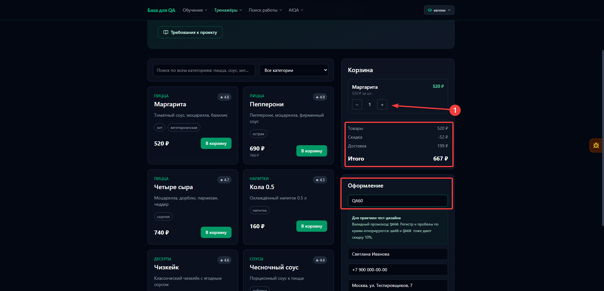
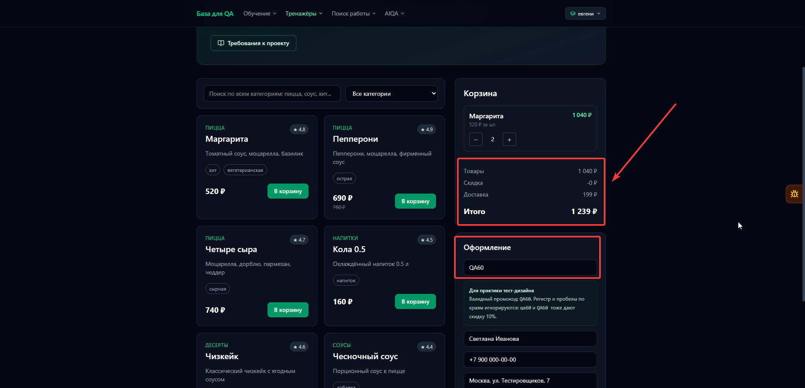
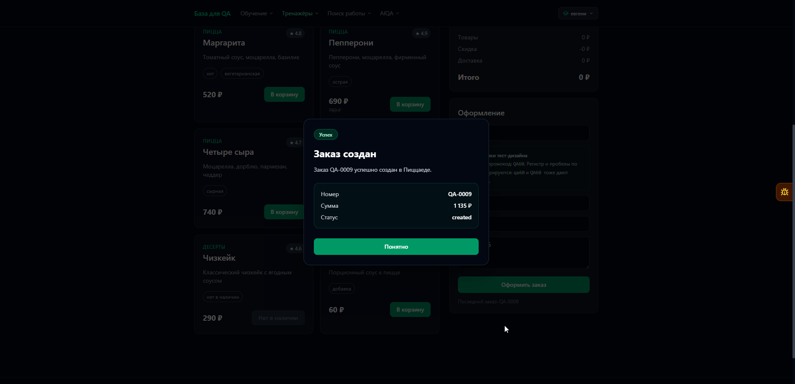

# BUG-001: Корзина показывает скидку 0 ₽ и неверную итоговую сумму после увеличения количества товара с QA60

## Общая информация

| Поле | Значение |
| --- | --- |
| Дата обнаружения | 2026-10-24 |
| Статус | Открыт |
| Основание | Нарушение требования |
| Серьёзность | Средняя |
| Приоритет | Средний |

## Окружение

- URL: [Пиццаед](https://aiqa.su/base/shop)
- ОС: Windows 11 Pro 24H2
- Браузер или API-клиент: Yandex 26.8.5.811 (64-bit)

## Предусловия и тестовые данные

- В корзине только «Маргарита», количество — 1, цена — 520 ₽.
- В поле промокода введено `QA60`, отображается скидка 52 ₽.

## Шаги воспроизведения

1. Увеличить количество «Маргариты» с 1 до 2.
2. Проверить отображаемые скидку и итоговую сумму в корзине.
3. Заполнить имя, телефон и адрес корректными тестовыми данными.
4. Не изменяя поле промокода, оформить заказ и сравнить сумму в popup с итогом корзины.

## Ожидаемый результат

В корзине автоматически отображается пересчитанная скидка 104 ₽ — 10% от суммы товаров 1040 ₽. Доставка составляет 199 ₽, итоговая сумма — 1135 ₽. Сумма в popup созданного заказа совпадает с итогом корзины. Повторный ввод промокода не требуется.

## Фактический результат

После увеличения количества в корзине отображается скидка 0 ₽, хотя в поле промокода остаётся `QA60`. Сумма товаров — 1040 ₽, доставка — 199 ₽, отображаемый итог — 1239 ₽ вместо ожидаемых 1135 ₽.

При оформлении без повторного ввода промокода скидка учитывается: в popup созданного заказа отображается корректная сумма 1135 ₽.

## Доказательства

До увеличения количества: «Маргарита» × 1, промокод `QA60`, скидка 52 ₽, итоговая сумма 667 ₽.

После увеличения количества: «Маргарита» × 2, в поле остаётся `QA60`, скидка 0 ₽, итоговая сумма 1239 ₽ вместо ожидаемых 1135 ₽.

После оформления: заказ создан со статусом `created` и корректной суммой 1135 ₽ с учётом скидки.

## Обходной путь

Очистить поле промокода и повторно ввести `QA60`, чтобы в корзине отобразились корректные скидка и итоговая сумма.
