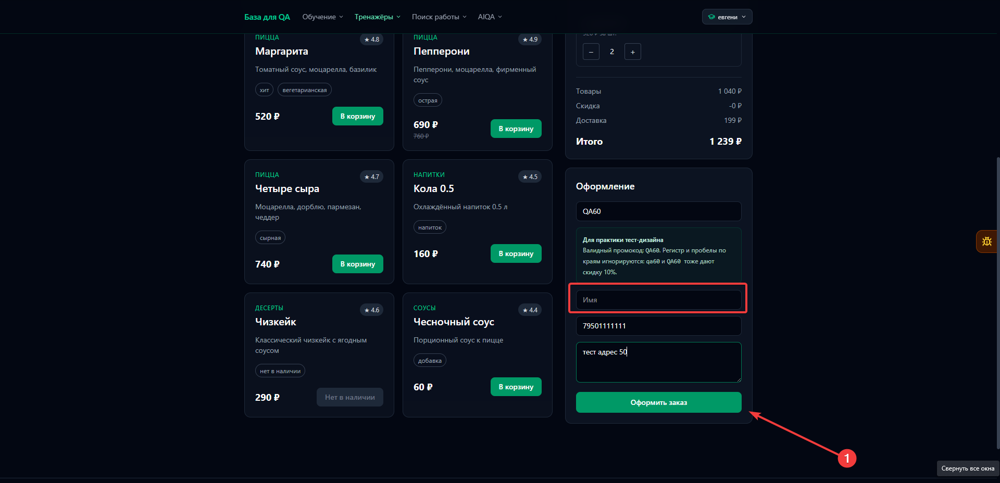
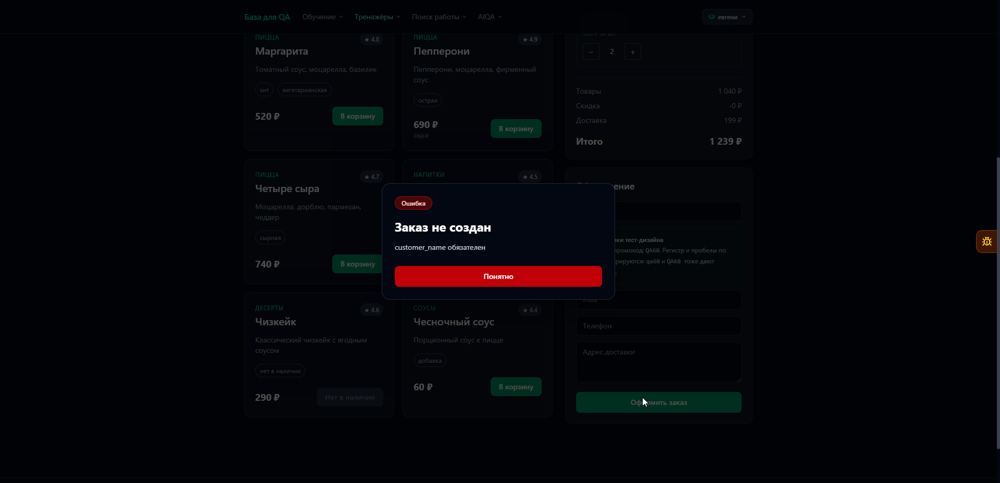

# BUG-002: В сообщениях об обязательных полях отображаются технические названия

## Общая информация

| Поле | Значение |
| --- | --- |
| Дата обнаружения | 2026-10-24 |
| Статус | Открыт |
| Основание | Потенциальный дефект |
| Серьёзность | Низкая |
| Приоритет | Низкий |

## Окружение

- URL: [Пиццаед](https://aiqa.su/base/shop)
- ОС: Windows 11 Pro 24H2
- Браузер или API-клиент: Yandex 26.8.5.811 (64-bit)

## Предусловия и тестовые данные

- В корзине есть доступный товар.
- Поля телефона и адреса заполнены корректными данными.
- Поле имени пустое.

## Шаги воспроизведения

1. Нажать кнопку «Оформить заказ».
2. Проверить текст ошибки в popup.
3. Повторить проверку с пустым телефоном и затем с пустым адресом, каждый раз заполняя остальные обязательные поля.

## Ожидаемый результат

Сообщение использует название поля из интерфейса, например «Укажите имя». Аналогично для телефона и адреса: «Укажите телефон», «Укажите адрес».

Ожидаемый результат предложен тестировщиком: требования к текстам ошибок отсутствуют.

## Фактический результат

В popup отображаются сообщения с техническими названиями полей.

| Незаполненное поле | Фактическое сообщение |
| --- | --- |
| Имя | `customer_name обязателен` |
| Телефон | `phone обязателен` |
| Адрес | `address обязателен` |

## Доказательства

Форма перед отправкой: поле имени пустое, телефон и адрес заполнены.

Popup с сообщением `customer_name обязателен`.

