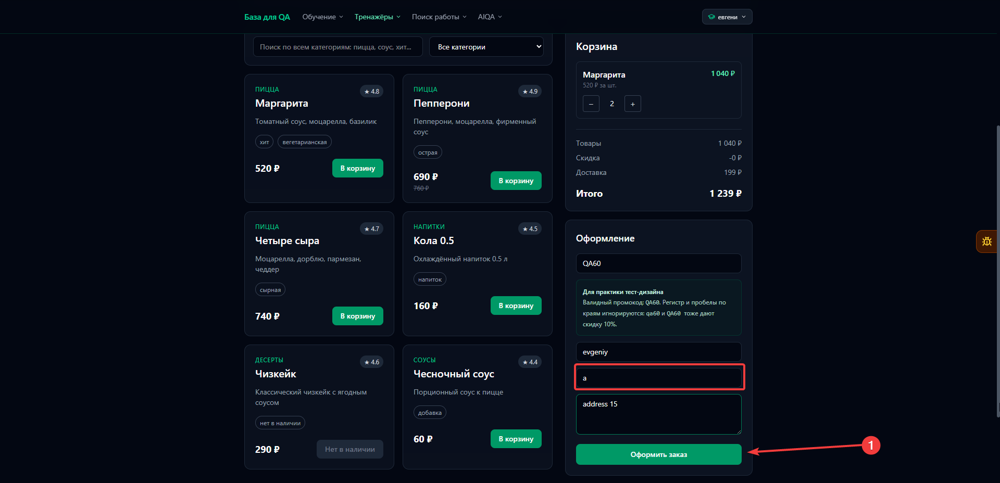
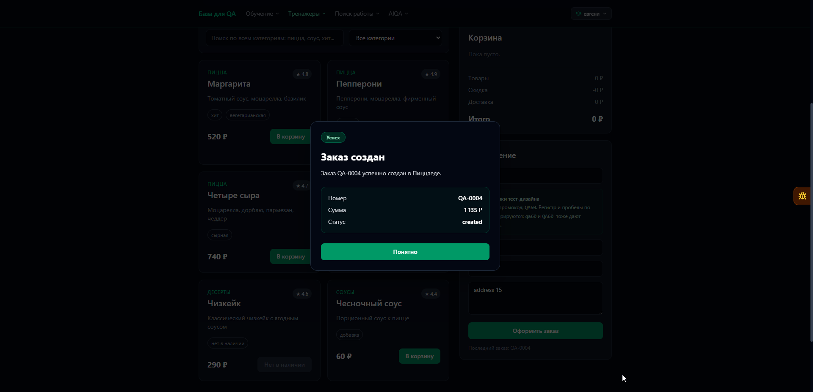

# BUG-003: Заказ оформляется с буквами или одним непробельным символом в поле телефона

## Общая информация

| Поле | Значение |
| --- | --- |
| Дата обнаружения | 2026-10-24 |
| Статус | Открыт |
| Основание | Потенциальный дефект |
| Серьёзность | Средняя |
| Приоритет | Средний |

## Окружение

- URL: [Пиццаед](https://aiqa.su/base/shop)
- ОС: Windows 11 Pro 24H2
- Браузер или API-клиент: Yandex 26.8.5.811 (64-bit)

## Предусловия и тестовые данные

- В корзине есть доступный товар.
- Имя и адрес заполнены корректными тестовыми данными.
- Поле телефона доступно для ввода.

## Шаги воспроизведения

1. Ввести в поле телефона одну букву, например "а".
2. Нажать кнопку «Оформить заказ».
3. Проверить результат оформления.

## Ожидаемый результат

Заказ не создаётся с телефоном из букв или одним символом, не представляющим номер телефона. Пользователь видит понятное сообщение о необходимости указать корректный номер.

## Фактический результат

Заказ успешно оформляется с буквами или одним непробельным символом в поле телефона. Ошибка формата телефона не отображается.

| Вариант значения телефона | Результат проверки |
| --- | --- |
| Буквы | Заказ оформляется |
| Один непробельный символ | Заказ оформляется |
| Пустая строка или только пробелы | Заказ не создаётся, отображается `phone обязателен` |

Система проверяет обязательность заполнения поля, но допускает значения, которые нельзя использовать для связи с покупателем.

## Доказательства

Перед оформлением: в поле телефона введена одна буква, остальные контактные поля заполнены.

После нажатия «Оформить заказ»: отображается popup успешного создания заказа со статусом `created`.

