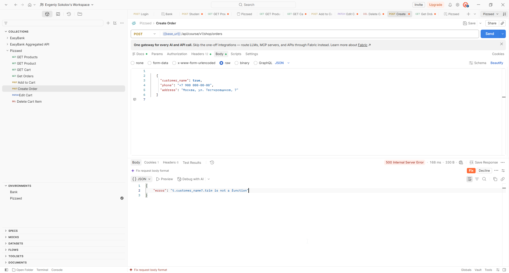

# BUG-004: API создания заказа возвращает 500 при передаче числа или boolean в контактных полях

## Общая информация

| Поле | Значение |
| --- | --- |
| Дата обнаружения | 2026-10-25 |
| Статус | Открыт |
| Основание | Нарушение требования |
| Серьёзность | Средняя |
| Приоритет | Средний |

## Окружение

- URL: `https://aiqa.su/api/course/v1/shop/orders`
- Метод: `POST`
- ОС: Windows 11 Pro 24H2
- API-клиент: Postman 12.31.0.

## Предусловия и тестовые данные

- В корзине текущей сессии есть доступный товар.
- В запросе указан заголовок `X-Course-Session` с идентификатором этой сессии.
- Тело передаётся в формате JSON с заголовком `Content-Type: application/json`.

## Шаги воспроизведения

1. Отправить `POST /api/course/v1/shop/orders` с телом:

   ```json
   {
     "customer_name": true,
     "phone": "+7 900 000-00-00",
     "address": "Москва, ул. Тестировщиков, 7"
   }
   ```

2. Проверить HTTP-статус и тело ответа.
3. Повторить запрос для остальных вариантов из таблицы ниже, каждый раз меняя тип только одного поля и оставляя остальные поля корректными строками.

## Ожидаемый результат

API отклоняет запрос со статусом `422` и JSON-ошибкой валидации соответствующего поля. Заказ не создаётся, корзина сохраняется.

## Фактический результат

API возвращает статус `500`. При `customer_name: true` тело ответа:

```json
{
  "error": "t.customer_name?.trim is not a function"
}
```

По результатам проверки проблема воспроизводится при передаче boolean и числовых значений в каждом контактном поле:

| Поле с неверным типом | Тип значения | HTTP-статус |
| --- | --- | --- |
| `customer_name` | Boolean | `500` |
| `customer_name` | Число | `500` |
| `phone` | Boolean | `500` |
| `phone` | Число | `500` |
| `address` | Boolean | `500` |
| `address` | Число | `500` |

Для сравнения: отсутствие обязательного поля, пустая строка и строка из пробелов корректно отклоняются со статусом `422`.

## Доказательства

Запрос создания заказа с `customer_name: true`: API возвращает `500 Internal Server Error` и сообщение `t.customer_name?.trim is not a function`.


